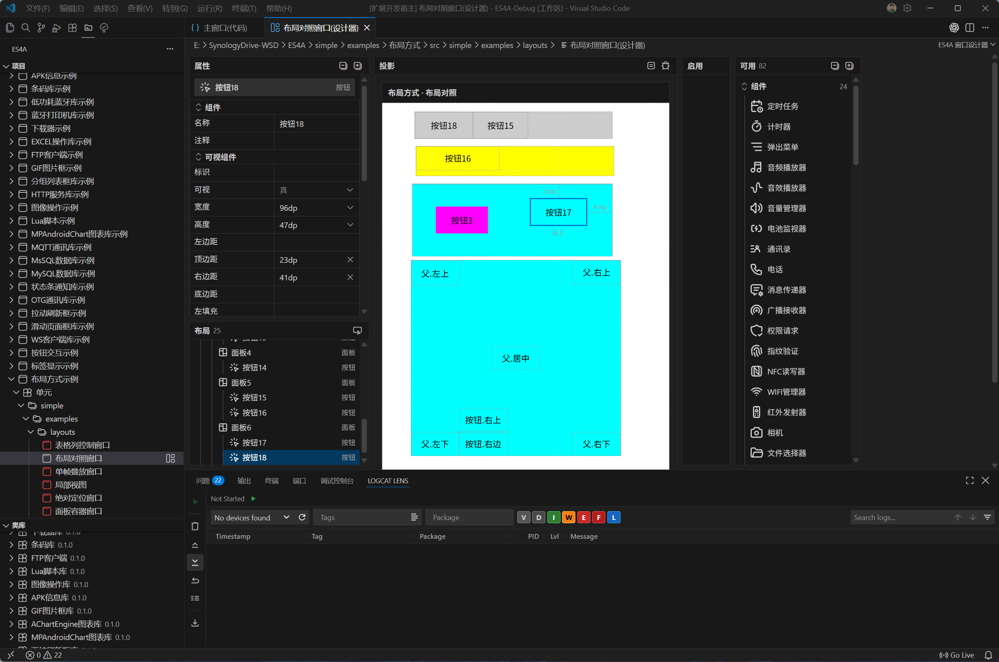
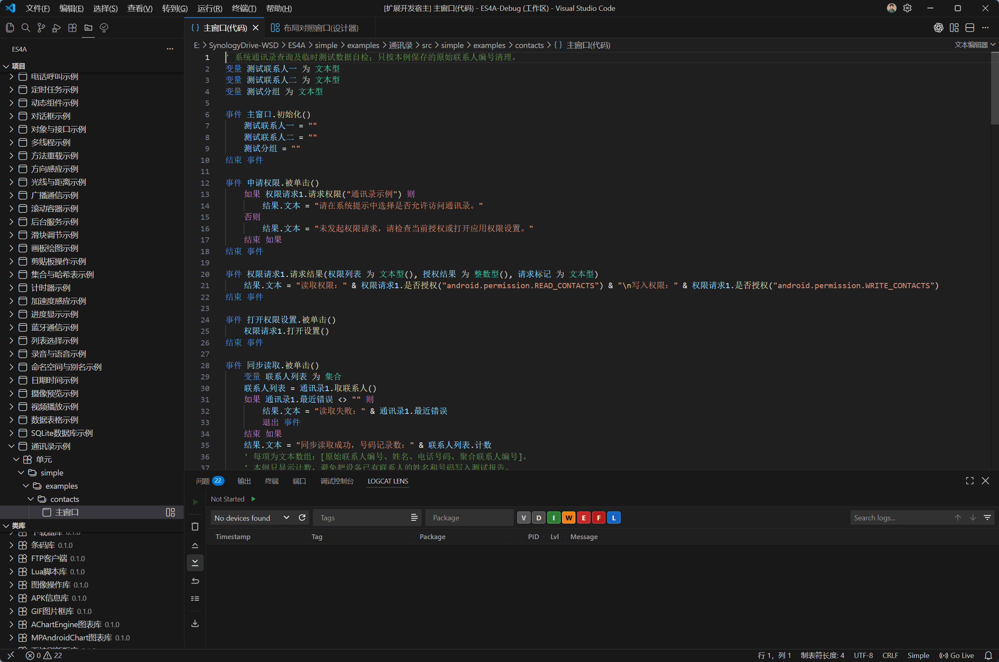

# ES4A 扩展

[ES4A](https://gitee.com/es4a) 是面向 Simple 中文编程语言的集成开发环境，当前以 Visual Studio Code 扩展形式提供。

Simple 采用类似 BASIC 的中文语法，面向 Android 应用开发。ES4A 集成项目管理、代码编辑、语言智能、窗口设计、资源管理及编译调试等能力，帮助具备基础编程知识的用户轻松上手 Android 应用开发。

## 界面预览

## 主要功能

- Simple 语法着色
- 代码提示、自动补全与参数提示
- 悬停信息、文档注释与转到定义
- 项目、单元及资源管理
- SDK 类库浏览与导航
- Android `res` 资源索引
- 可视化窗口布局设计
- 应用编译与一键调试
- 等等...

## 快速上手

1. [下载扩展](https://dwz.wsd.cx/es4a-vsix)，在 VS Code 中通过“从 VSIX 安装”完成安装。
2. [下载 SDK](https://dwz.wsd.cx/es4a-sdk)，解压后按其中的 README 准备工具。
3. 打开 ES4A“类库”视图，选择所用 SDK 入口清单 `sdk.json`；使用本地配置时选择 `sdk.local.json`。
4. 创建或打开 Simple 项目，按 F5 编译运行。

> 可安装 Logcat 扩展查看 Android 应用日志。

## 小技巧

依次按 `Ctrl+K`、`Ctrl+S` 打开“键盘快捷方式”，搜索命令即可查看用途和当前快捷键，也可自行修改。

在代码中变量、参数、成员变量或组件名称的声明／引用处按 `F2` 可重命名并重构关联引用；组件同时更新 XML 名称，名称重复或冲突时拒绝修改。`F2` 是主动重构，不受自动重构开关控制。

在定义处修改变量名后，离开声明行、在名称后输入空格、切换编辑器或手动保存时，会自动重构引用。变量、组件、单元和包的自动重构可在 ES4A 设置中分别关闭。

文件改名的关联重构使用 VS Code 原生确认和预览，保留“确定”“显示预览”“跳过更改”及“不再询问”复选框。

## 相关链接

- [开源仓库](https://gitee.com/es4a)
- [留言反馈](https://dwz.wsd.cx/wsd-ly)
