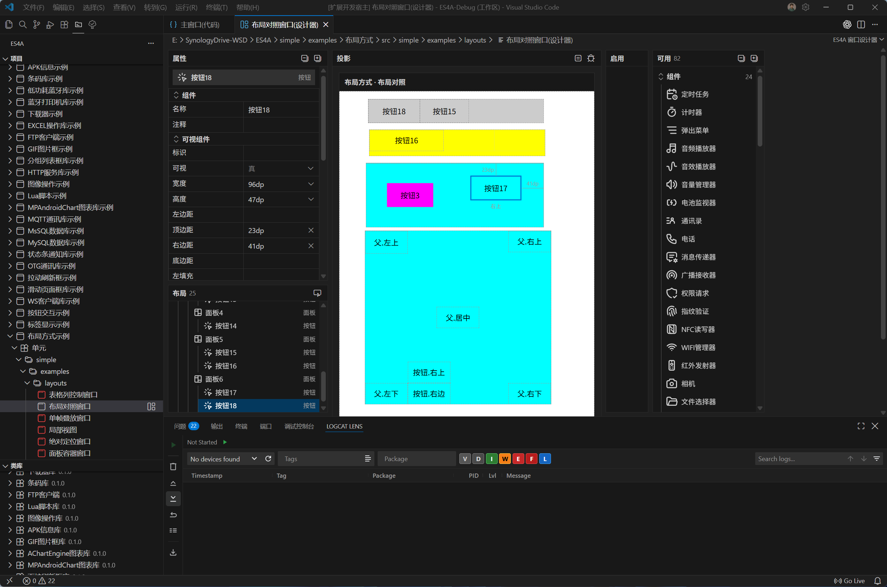
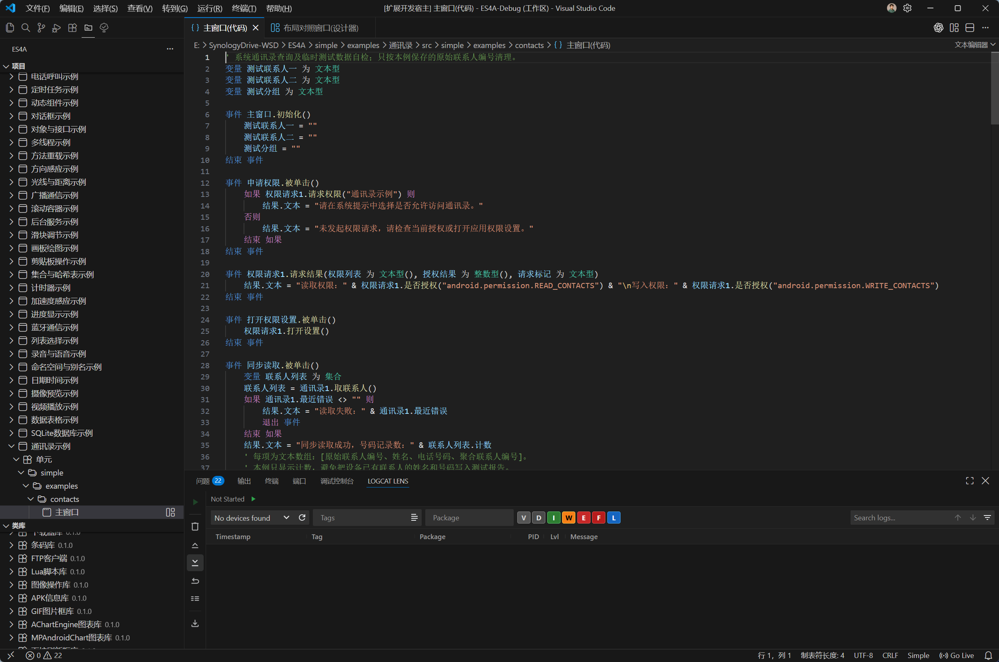

# ES4A 扩展

基于 [Simple 中文语言](https://gitee.com/es4a/sdk/blob/main/docs/Simple语言定义.md)的 Android 应用开发工具，提供代码编辑、窗口设计和编译运行等功能。

## 界面预览

 

## 主要功能

- 语法着色、代码补全、参数提示与引用导航
- 项目、单元、资源与类库管理
- 可视化窗口设计
- 应用编译与调试

## 快速上手

1. [下载完整 SDK](https://dwz.wsd.cx/es4a-sdk)并解压。
2. 在 ES4A“类库”视图中选择 SDK 根目录。
3. 在“项目”视图中创建或打开 Simple 项目，并打开其中的 Simple 单元。
4. 连接 Android 设备或启动模拟器，按 `F5` 编译运行。

语法和项目开发说明见 [SDK 文档](https://gitee.com/es4a/sdk/blob/main/docs/README.md)。

## 小技巧

- 按 `Ctrl+K`、`Ctrl+S` 查看或修改快捷键。
- 在变量或组件名称处按 `F2`，重命名并同步关联引用。

## 相关链接

- [扩展安装包](https://dwz.wsd.cx/es4a-vsix)
- [开源仓库](https://gitee.com/es4a)
- [留言反馈](https://dwz.wsd.cx/wsd-ly)
